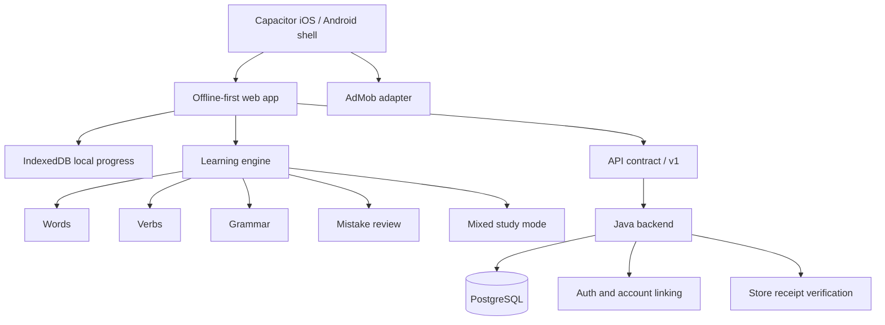

# LernWerk architecture (0.1)

## Architectural decisions

- Mobile shell: Capacitor 8, one shared web codebase for Android and iOS.
- Client: responsive PWA / web app; current prototype stores state in IndexedDB.
- Backend: Java 21 core domain; the included HTTP server is a local integration shell only. A production Spring Boot adapter, JWT/OIDC authentication, PostgreSQL persistence, validation, rate limiting and audit logs are next backend tasks.
- Offline-first: guest progress stays on device; no account is necessary for local learning. Account linking later uploads a user-approved local snapshot and merges by item/session IDs.
- Content: canonical IDs, level, type, topic, source attribution and language translations are stored separately.
- Pro: entitlement must be verified server-side with Apple App Store Server API / Google Play Developer API; never trust a client-only boolean.

## Content stage sequence

A1 words -> A1 verbs -> A1 grammar -> A1 mixed revision -> A2 words -> A2 verbs -> A2 grammar -> A2 mixed revision -> B1 words -> B1 verbs -> B1 grammar -> DTZ exam practice.

The current bundled A1 data is a small demonstration dataset, not a complete official word list. A2 and B1 content packs have not yet been curated.
